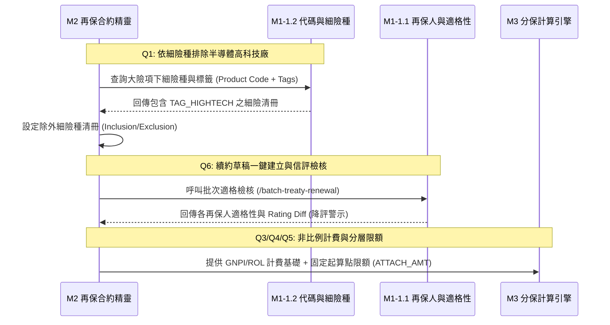

# 台灣產險通用型再保管理系統
# M1 主檔｜需求規格異動完整對照草案 (v0.92 審查專用版)

| 項目 | 內容說明 |
|---|---|
| **文件編號** | `RS-M1-CR092-DRAFT` |
| **版本狀態** | **v0.92 審查草案 (Draft for Review)** |
| **產出日期** | 2026-11-13 |
| **涵蓋文件** | `1.1 再保人與再保經紀人管理 (v0.9)` ＆ `1.2 代碼、險種對照與匯率 (v0.9)` |
| **修訂依據** | 審核意見書《`Risure_reviewed(M1-M2).docx`》產險實務與法規回饋（Q1~Q6） |
| **研擬角色** | 【再保專家】(Reinsurance Domain Expert) ＆ 【商業分析師】(Business Analyst) |
| **文件效力說明** | **本草案為審核專用之完整條文對照版，原 v0.9 需求分析文件正本維持不變（不覆蓋）。** 待專案主持人與利害關係人完成審閱決議後，再行將通過之內容正式合併更新至 v0.92 正本。 |

---

## 目錄
- [第 1 章　異動背景與整體架構影響](#第-1-章異動背景與整體架構影響)
- [第 2 章　《1.2 代碼、險種對照與匯率》異動完整條文](#第-2-章12-代碼險種對照與匯率異動完整條文)
  - [2.1 【FR-03 險種對照維護】升級為三層階層與除外標籤](#21-fr-03-險種對照維護升級為三層階層與除外標籤)
  - [2.2 【BR-04 業務規則】修正](#22-br-04-業務規則修正)
  - [2.3 【FR-01 代碼表維護】擴充系統共用代碼表](#23-fr-01-代碼表維護擴充系統共用代碼表)
  - [2.4 【附錄 B.1 代碼表】新增 4 組標準代碼清單](#24-附錄-b1-代碼表新增-4-組標準代碼清單)
  - [2.5 【第 7 章 資料需求】新增商品主檔與屬性實體](#25-第-7-章-資料需求新增商品主檔與屬性實體)
- [第 3 章　《1.1 再保人與再保經紀人管理》異動完整條文](#第-3-章11-再保人與再保經紀人管理異動完整條文)
  - [3.1 【FR-06 適格判斷服務】擴充：續約陣容批次預檢服務](#31-fr-06-適格判斷服務擴充續約陣容批次預檢服務)
  - [3.2 【CR-03 適格判斷決策表】增列續約批次預檢用途 (G_RNW)](#32-cr-03-適格判斷決策表增列續約批次預檢用途-g_rnw)
  - [3.3 【BR-24 門檻跨越事件】影響範圍擴大至續約草稿](#33-br-24-門檻跨越事件影響範圍擴大至續約草稿)
  - [3.4 【第 8 章 建議 API 端點】新增批次續約檢核端點](#34-第-8-章-建議-api-端點新增批次續約檢核端點)
- [第 4 章　跨模組依賴與後續 M2 審核銜接](#第-4-章跨模組依賴與後續-m2-審核銜接)

---

# 第 1 章　異動背景與整體架構影響

在審核意見書《`Risure_reviewed(M1-M2).docx`》中，針對 M2 再保合約管理提出了 6 大實務議題：
1. **Q1 險種顆粒度**：合約適用業務範圍不能僅停留在「大險別（如商業火險 F01）」，實務上必須能精確至「細險種商品代碼（Product Code）」，以支援除外半導體高科技廠或特定政策性險種。
2. **Q2 分層再保人配置**：多層合約（Layer 1 / Layer 2）由不同再保人陣容承接，簽單比例獨立檢核 100%，並可能涉及不同的經紀人鏈與收款銀行帳號。
3. **Q3 & Q5 非比例保費費率與計費基礎**：非比例合約（XOL）必須具備獨立再保費率、最低預付保費（MDP）與計費基礎（GNPI、Rate on Line、OGP）。
4. **Q4 車險 0 起算分層限額**：車險 0~400 萬、400~1,200 萬分層，自留為 0 時溢額線數（Lines）公式失效，合約限額必須支援「起算點 (Attachment Point) ＋ 固定金額限額」模式。
5. **Q6 到期預警與續約草稿**：合約到期前 D-90 自動產出續約草稿時，必須自動比對最新信用評等，防杜降評不適格對象，並避免與 2.4 年度合約轉換案重複建立草稿。

經【再保專家】與【BA】研討，上述 M2 的新業務需求**高度依賴 M1 主檔的底層支撐**。若 M1 未建立細險種代碼對照、未定義計費/限額代碼表、未提供續約適格性批次預檢服務，M2 合約管理模組將成為「無源之水」。因此，依據工程標準，必須先完成 M1 規格草案的完整擬定。

---

# 第 2 章　《1.2 代碼、險種對照與匯率》異動完整條文

## 2.1 【FR-03 險種對照維護】升級為三層階層與除外標籤

### 原 v0.9 條文：
> **FR-03 險種對照維護**
> 說明：系統應維護「原保險種（含細險種）→ 再保險別 → 適用危險事故」對照，並在原保險種上維護境外投保許可與傷害健康旗標。
> 處理邏輯：
> 1. 原保險種清單由核保系統同步（FR-04）或人工建立。
> 2. 對照以生效日管理；同一險種在同一日期只能對照一個再保險別（BR-04）。
> 3. 再保險別屬性：名稱、類別（財產、工程、水險、責任、傷害健康、其他）、適用危險事故清單。
> 4. 原保險種旗標：境外投保許可、傷害健康，各附生效期間，由法遵申請、另一位法遵核准。
> 5. 對照變更時發布事件，M2 產生受影響的合約適用範圍與計畫限額查表清單，通知再保主管。

### 建議修改為（v0.92 草案）：
> **FR-03 險種對照與商品主檔階層維護 (Product Hierarchy & Code Mapping)**
> 
> **說明**：
> 系統應建立並維護台灣產險標準三層式商品結構：**「大險 (Major Line) $
ightarrow$ 中險 (Sub Line) $
ightarrow$ 細險種/商品代碼 (Product Code)」**，並維護「細險種 $
ightarrow$ 再保險別 $
ightarrow$ 適用危險事故 (PER)」之映射關聯。同時於細險種層級維護商品業務屬性標籤（Product Tags）、結構化除外分類標記、境外投保許可與傷害健康旗標，以供 M2 合約主檔設定結構化除外（Exclusions）與納入清冊（Inclusions）比對。
> 
> **處理邏輯**：
> 1. **商品階層架構**：
>    - **大險 (Major Line)**：依公會大類分類（如 01 火險、02 水險、03 陸空保險、04 責任險、05 保證險、06 其他財產、07 車險、08 傷害健康）。
>    - **中險 (Sub Line)**：大險項下業務次分類（如火險項下：一般商火、住火、營業中斷險、高科技特約火險）。
>    - **細險種/商品代碼 (Product Code)**：核心出單系統與保單範本之細險代碼（如 `F0101` 一般商火、`F0102` 營業中斷險、`F0199` 電子半導體專案火險、`A0101` 車體甲式、`A0102` 車體乙式）。
> 2. **原保細險種清單取得**：
>    - 支援由核保/出單核心系統透過 API 同步、每日批次介接或 CSV 檔案批次匯入（FR-04）。
> 3. **商品業務屬性標籤 (Product Tags) 維護**：
>    - 每一細險種可配置多個業務分類標籤，作為 M2 合約過濾條款之預設依據：
>      * `TAG_HIGHTECH`：電子高科技 / 半導體製造廠（商業火險常見除外業務）
>      * `TAG_POLICY`：政策性保險（如住宅地震基本保險、強制車險）
>      * `TAG_SPEC_VEHICLE`：特種車輛 / 高自負額營業車輛
>      * `TAG_OVERSEAS_PERMIT`：境外投保許可（再保辦法第9條第2項但書）
>      * `TAG_ACCIDENT_HEALTH`：傷害健康保險（保險法第138條人身業別過濾）
> 4. **對照生效日管理**：
>    - 對照以生效起訖日管理；同一細險種代碼在同一日期區間內，只能對照到一個再保險別（BR-04）。
> 5. **對照變更事件發布**：
>    - 當細險種之所屬再保險別變更或屬性標籤異動時，系統自動發布事件；M2 訂閱事件後自動重算受影響合約之「適用細險種清單」與「自留額/計畫限額查表」，並通知再保主管。
> 
> **適用規則**：BR-04、BR-06、BR-07、BR-16、BR-17
> 
> **例外處理**：
> - 同一細險種代碼在重疊有效期間內試圖對照至兩個不同再保險別 $
ightarrow$ 系統嚴格阻擋並提示錯誤。
> - 核保核心傳入未定義之細險種代碼 $
ightarrow$ 依 FR-04 觸發未對照偵測並攔阻分保試算。
> 
> **驗收條件**：
> - **AC-1 (階層連動)**：建立 M2 合約時，勾選大險別（如商業火險 F01）後，系統能自動列出項下所屬之中險與細險種清單，並依商品標籤預設納入或除外。
> - **AC-2 (期間重疊防呆)**：同一細險種在期間重疊時拒絕存檔第二筆有效對照。
> - **AC-3 (除外精準過濾)**：M3 執行分保計算時，屬於 `TAG_HIGHTECH` 標籤且被合約標記為 Exclude 之保單，系統自動排除於該溢額合約之外，不得分入。
> - **AC-4 (批次匯入驗證)**：匯入包含 200 筆細險種之 CSV 檔，系統正確解析大/中/細險層級，並於 3 秒內完成對照檢核與存檔。
> 
> **來源**：[2020 規格 LoB 保單樣板、再保商品管理] [審核意見書 Risure_reviewed(M1-M2).docx Q1] [法規：再保辦法 第9條第2項]
> **狀態**：可寫 (待審核確認)

---

## 2.2 【BR-04 業務規則】修正

### 原 v0.9 條文：
> | BR-04 | 核保系統的每一個險種（含細險種），在任一日期只能對照到一個再保險別；沒有有效對照時不得自動歸入任何預設險別。 | 【設計原則】 | — | [2020 規格 再保策略管理] |

### 建議修改為（v0.92 草案）：
> | BR-04 | 核保系統的每一個商品細險種代碼（Product Code），在任一日期區間內只能且必須精確對照到一個再保險別（Reinsurance LoB）；並依附於標準大險與中險階層下。沒有有效對照時不得自動歸入任何預設險別，一律依 P-06 攔阻。細險種之商品屬性標籤（Product Tags）由參數管理者維護並經覆核生效。 | 【設計原則】 | — | [2020 規格 再保策略管理] [審核意見書 Q1] |

### 新增業務規則 BR-17：
> | BR-17 | 細險種商品代碼唯一性與合約除外清冊繼承：M2 再保合約之適用範圍預設繼承該再保險別項下之全數有效細險種清單；合約端可針對特定細險種或商品標籤（如 `TAG_HIGHTECH`）宣告為「除外 (Exclusion)」。宣告為除外之商品細險代碼，其保單在 M3 分保計算時嚴禁分入該合約。 | 【設計原則】 | — | [審核意見書 Risure_reviewed Q1] |

---

## 2.3 【FR-01 代碼表維護】擴充系統共用代碼表

### 原 v0.9 條文：
> **FR-01 代碼表維護**
> 說明：系統應提供共用代碼表框架，各模組的代碼（例如 4.2 的 LYR、CMB、FCP、ATB、RSN、PER、PMS；1.1 的 PTY、BIZ、LIC、AGY、RTT、ELG、RLS）在此維護。

### 建議修改為（v0.92 草案）：
> **FR-01 代碼表維護**
> 
> **說明**：
> 系統應提供共用代碼表統一管理框架，除既有主檔與分保代碼外，本功能正式納管因應非比例計費、多層限額模式、合約續約生命週期及非比例復原條件所必需之全域系統代碼表（包含 `PRM_BASE`、`LMT_MODE`、`RNW_STATUS`、`REINST_TYPE` 等）。
> 
> **處理邏輯**：
> 1. （維持原 1~4 點邏輯，增加系統內建代碼清冊規範）。
> 2. 凡標記為【核心運算相依】之代碼值，由系統內建鎖定，不允許使用者停用或刪除，僅允許修改中文說明與顯示排序。

---

## 2.4 【附錄 B.1 代碼表】新增 4 組標準代碼清單

在附錄 B.1 正式補入以下 4 組系統核心代碼表：

### 1. `PRM_BASE` 再保保費計費基礎代碼 (Premium Calculation Base)
> 用途：M2 Step 3 及 XOL 合約設定保費計費依據，連動 M5 分出保費出帳與結算。
> 
> | 代碼 | 中文名稱 | 英文名稱 | 適用合約型態 | 業務說明 |
> |---|---|---|---|---|
> | **`GNPI`** | 淨簽單保費收入基礎 | Gross Net Premium Income | 非比例 (XOL) | 依適用業務之實際毛簽單保費扣除退保與直接手續費後乘以再保費率計算；台灣產險市場 XOL 最主流計費基礎。 |
> | **`ROL`** | 合約責任額/保額基礎 | Rate on Line | 非比例 (XOL) | 以合約最高承保責任額度（Capacity Limit）乘以 Rate on Line 費率計算固定或預付保費；巨災險高層（Top Layer）常用。 |
> | **`OGP`** | 原保單保費比例分攤 | Original Gross Premium | 比例 (QS/Surplus) | 直接按再保分出保額佔原保單保額之比例，分享原保單保費；比例型合約之預設計費基礎。 |

### 2. `LMT_MODE` 合約層級限額模式代碼 (Layer Limit Mode)
> 用途：M2 Step 2 設定合約各層之能量計算邏輯，解決車險等自留為 0 時線數公式失效之問題。
> 
> | 代碼 | 中文名稱 | 英文名稱 | 業務說明 |
> |---|---|---|---|
> | **`LINE`** | 線數倍數模式 | Lines-based Limit | 本層分保上限＝基本自留額 (1 Line) $	imes$ 線數 (Lines)；傳統火險、水險溢額合約（Surplus）標準模式。 |
> | **`ATTACH_AMT`** | 起算點與固定金額模式 | Attachment Point & Fixed Amount | 支援設定起算點（起賠點/Deductible）與本層固定保額上限；適用於車險 0~400 萬、400~1,200 萬分層、責任險及 XOL 合約。 |

### 3. `RNW_STATUS` 合約續約生命週期狀態代碼 (Renewal Status)
> 用途：M2 合約主檔清單與到期預警儀表板標示續約進度，支援 D-90 自動推播與防重複建檔。
> 
> | 代碼 | 中文名稱 | 英文名稱 | 業務說明 |
> |---|---|---|---|
> | **`ACTIVE`** | 履約中 | Active In-force | 合約仍在有效期內，尚未達續約籌備期。 |
> | **`D_90_ALERT`** | 續約籌備中 (D-90) | Renewal Due (D-90 Alert) | 距合約滿期已達 D-90 天，系統已啟動續約通知提醒。 |
> | **`DRAFT_CREATED`** | 續約草稿已建立 | Renewal Draft Created | 已產出新年度合約草稿或已納入 2.4 轉換專案洽談中；**鎖定禁止重複產生草稿**。 |
> | **`RENEWED`** | 已完成新年度續約 | Successfully Renewed | 新年度續約合約已簽署確認並生效，本合約將於到期日自動封存。 |
> | **`NON_RENEW`** | 不續約 | Non-Renewed / Terminated | 經業務決定不予續約，到期後不再保護。 |

### 4. `REINST_TYPE` 非比例合約復原保費條款代碼 (Reinstatement Type)
> 用途：M2 非比例合約 Step 3 設定超額賠款出險後責任額度復原條件。
> 
> | 代碼 | 中文名稱 | 英文名稱 | 業務說明 |
> |---|---|---|---|
> | **`FREE`** | 免費復原 | 100% Free Reinstatement | 賠款耗損合約額度後，自動免費復原約定次數之責任額度。 |
> | **`PRO_RATA_PREM`** | 按未滿期保費比例收費 | Pro-rata as to Premium (50%/100%) | 依當年度未滿期天數比例計收復原保費。 |
> | **`PRO_RATA_CAP`** | 按賠款金額比例收費 | Pro-rata as to Amount | 依本次出險消耗之保額責任比例計收復原保費。 |
> | **`NONE`** | 不得復原 | No Reinstatement | 合約責任額度消耗完畢即告終止。 |

---

## 2.5 【第 7 章 資料需求】新增商品主檔與屬性實體

在第 7.1 節新增邏輯資料實體：
```
ProductHierarchy (商品階層實體)
  ├── majorLineCode (大險代碼, PK)
  ├── subLineCode (中險代碼, PK)
  ├── productCode (細險種商品代碼, PK)
  ├── productName (商品中文名稱)
  ├── effectiveDate (生效日期)
  ├── expiryDate (失效日期)
  ├── reinsuranceLobCode (對照再保險別代碼, FK)
  ├── isHighTechExclude (是否屬高科技除外標籤, Boolean)
  ├── isPolicyInsurance (是否屬政策性保險標籤, Boolean)
  └── autoCoverType (車險類別: COMPREHENSIVE_A / B / C / NONE)
```

---

# 第 3 章　《1.1 再保人與再保經紀人管理》異動完整條文

## 3.1 【FR-06 適格判斷服務】擴充：續約陣容批次預檢服務

### 原 v0.9 條文：
> **FR-06 適格判斷服務**
> 說明：系統應提供同步服務：輸入再保人、經紀人（可空白）、國外經紀人（可空白）、判斷日、用途、分出險種，依 CR-03 回傳適格結果、依據條款、內規可選用標記、使用的評等、門檻表版本、讀法設定、集團內旗標、警示訊息。呼叫端應保存回傳的完整結果為快照。

### 建議修改為（v0.92 草案）：
> **FR-06 適格判斷與續約批次預檢服務 (Eligibility Validation & Renewal Pre-check)**
> 
> **說明**：
> 系統應提供即時同歩適格判斷服務。除既有單筆呼叫介面外，**新增專為「M2 合約續約 (Treaty Renewal) 與 D-90 自動產出草稿」設計之『合約再保人陣容批次預檢服務』**。此服務能一次傳入新年度擬續約之多層（Multi-layer）再保人名單，自動比對判斷日有效之國際評等（S&P、Moody's、A.M. Best、Fitch、中華信評）與洗錢/制裁名單，回傳各再保人之最新適格狀態，並精準計算**相較前手合約之信用變化（Rating Diff）與降評違規警示**。
> 
> **處理邏輯**：
> 1. （維持原單筆判斷 1~6 點邏輯）。
> 2. **批次續約預檢邏輯**：
>    - 接收 M2 傳入之前手合約編號、新年度起保日、合約多層再保人陣容清冊（含層別、再保人 ID、角色、簽單份額 Signed Line %）。
>    - 逐筆依據 `CR-01`、`CR-02` 及 `CR-03 (用途 G_RNW)` 判定各再保人在新年度起保日的適格狀態（ELI/NEL/MAN）。
>    - **信評差異分析 (Rating Diff)**：自動比對前手合約存檔之評等快照與新判斷日評等：
>      * 若最新評等維持門檻以上 $
ightarrow$ 標記 `STATUS_OK: 適格 (Eligible)`。
>      * 若評等下滑但仍高於法定門檻 $
ightarrow$ 標記 `WARN_DOWNGRADE: 降評預警 (Still Eligible)`。
>      * 若評等下滑已跌破第 8 條或第 12 條法定門檻 $
ightarrow$ 標記 `BREACH_UNQUALIFIED: 不適格違規 (Disqualified - Must Replace or Collateralize)`，回傳錯誤碼並要求更換再保人或提存擔保品。
> 3. **呼叫端快照保存**：
>    - M2 於建立續約草稿時，將本服務回傳之完整評等歷程、判定依據與差異標記，完整寫入新年度合約之「再保人適格性快照表 (Treaty Panel Snapshot)」。
> 
> **適用規則**：BR-18、BR-19、BR-20、BR-21、BR-24、CR-01～CR-03
> 
> **驗收條件**：
> - **AC-1 (單筆相容)**：既有 M2/M4 單筆適格判斷呼叫維持 100% 向下相容。
> - **AC-2 (續約批次判定)**：傳入包含 10 家再保人（分屬 Layer 1 與 Layer 2）之續約請求，系統於 1.5 秒內回傳全數再保人之新年度適格判定與依據條款。
> - **AC-3 (降評即時防呆)**：若名單中某再保人過去一年內評等由 A- 降至 BBB-（低於第 12 條標準），回傳結果明確標記 `BREACH_UNQUALIFIED`，且 M2 續約草稿畫面上該再保人列呈現紅字警示，禁止直接完成續約。

---

## 3.2 【CR-03 適格判斷決策表】增列續約批次預檢用途 (G_RNW)

在第 3.5 節 `CR-03` 計算規則中：
- **輸入用途代碼 (Purpose Code)** 擴充：
  * 既有用量：`G8`（第7/8條一般分出適格）、`G12`（第11/12條合格承接者）、`G18`（第18條非傳統再保對象）。
  * **新增用量**：`G_RNW`（**合約新年度續約草稿批次預檢**）。
- **G_RNW 判定邏輯**：
  * 比照 `G8`（比例）或 `G12`（非比例）門檻，但強制執行「信用評等歷程比對」，計算輸出欄位 `RatingDiffStatus`（維持/升評/降評預警/跌破門檻）。

---

## 3.3 【BR-24 門檻跨越事件】影響範圍擴大至續約草稿

### 原 v0.9 條文：
> | BR-24 | 評等跨越第 8 條、第 12 條門檻時，系統通知並發布事件；M2、M4 訂閱事件，產生受影響的有效合約與臨分清單。 | 【設計原則】 | — | F_08 RA-053 [業界通用] |

### 建議修改為（v0.92 草案）：
> | BR-24 | 評等跨越第 8 條、第 12 條門檻（降評跌破門檻或升評符合）時，系統發布即時廣播事件。M2 訂閱事件後，除產生受影響之「有效合約 (Active Treaties)」清單外，**必須同時掃描並更新「D-90 續約籌備中及草稿狀態 (Draft Treaties)」之合約名單**；若草稿中含有降評違規之再保人，系統立即於草稿標記不適格警示並通知再保經辦與覆核主管，防止簽署不合規之新年度合約。 | 【設計原則】 | — | [審核意見書 Risure_reviewed Q6] |

---

## 3.4 【第 8 章 建議 API 端點】新增批次續約檢核端點

在第 8.2 節 API 端點清單中新增：
| 名稱 | 方法 | 路徑 | 說明 |
|---|---|---|---|
| 合約陣容批次續約適格檢核 | `POST` | `/eligibility-checks/batch-treaty-renewal` | 傳入多層合約再保人名單，回傳新年度適格判定、評等快照與信評差異 (Rating Diff)。 |

---

# 第 4 章　跨模組依賴與後續 M2 審核銜接



### 總結效益：
1. **M1 奠定基礎**：透過上述 M1 的擴充，既完整解鎖了合約精靈（M2）所需的底層主檔支援，又嚴格遵循專案之架構決策（AD）與法規防線。
2. **原檔安全不變**：本份草案獨立保存於 `M1_主檔_需求規格異動完整對照草案_v0.92.md`，絕不改動或覆蓋任何現有 `v0.9` 原檔。
3. **後續步驟**：本草案經專案主管審核通過後，可接續進行 **《M2 合約管理需求規格異動對照草案》**（2.1~2.4）之編製！
