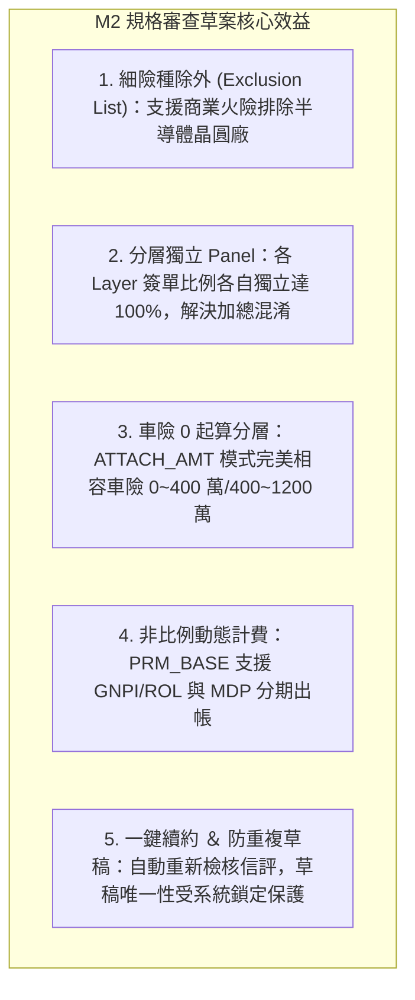

# 台灣產險通用型再保管理系統
# M2 合約管理｜需求規格異動完整對照草案 (v0.92 審查專用版)

| 項目 | 內容說明 |
|---|---|
| **文件編號** | `RS-M2-CR092-DRAFT` |
| **版本狀態** | **v0.92 審查草案 (Draft for Review)** |
| **產出日期** | 2026-11-13 |
| **涵蓋文件** | `2.1 風險管理計畫 (v0.9)`、`2.2 合約主檔與版本 (v0.9)`、`2.3 合約安排與文件 (v0.9)`、`2.4 年度合約轉換 (v0.9)` |
| **修訂依據** | 審核意見書《`Risure_reviewed(M1-M2).docx`》產險實務與法規回饋（Q1~Q6） |
| **研擬角色** | 【再保專家】(Reinsurance Domain Expert) ＆ 【商業分析師】(Business Analyst) |
| **文件效力說明** | **本草案為審核專用之完整條文對照版，原 v0.9 需求分析文件正本維持不變（不覆蓋）。** 待專案主持人與利害關係人完成審閱決議後，再行將通過之內容正式合併更新至 v0.92 正本。 |

---

## 目錄
- [第 1 章　異動背景與 6 大議題在 M2 的系統映射](#第-1-章異動背景與-6-大議題在-m2-的系統映射)
- [第 2 章　《2.2 合約主檔與版本》異動完整條文](#第-2-章22-合約主檔與版本異動完整條文)
  - [2.1 【FR-05 適用範圍】與【FR-06 除外業務】升級為細險種 Inclusion/Exclusion 清冊](#21-fr-05-適用範圍與-fr-06-除外業務升級為細險種-inclusionexclusion-清冊)
  - [2.2 【FR-10 比例合約試算屬性】擴充：支援『起算點 ＋ 固定金額限額模式』(LMT_MODE)](#22-fr-10-比例合約試算屬性擴充支援起算點--固定金額限額模式lmt_mode)
  - [2.3 【FR-18 XOL保費條件】與【FR-25 保費基礎】擴充：非比例動態表單與計費基礎 (PRM_BASE)](#23-fr-18-xol保費條件與-fr-25-保費基礎擴充非比例動態表單與計費基礎-prm_base)
  - [2.4 【FR-37 陣容資料結構】與【FR-39 成分合計檢核】升級：分層獨立 Panel (Layer Tabs)](#24-fr-37-陣容資料結構與-fr-39-成分合計檢核升級分層獨立-panel-layer-tabs)
  - [2.5 【FR-46 合約狀態與生命週期】擴充：D-90 到期預警與續約狀態 (RNW_STATUS)](#25-fr-46-合約狀態與生命週期擴充d-90-到期預警與續約狀態-rnw_status)
- [第 3 章　《2.4 年度合約轉換》異動完整條文](#第-3-章24-年度合約轉換異動完整條文)
  - [3.1 【FR-02 建立新年度合約草稿】擴充：一鍵續約、信評自動重算與防重複草稿機制](#31-fr-02-建立新年度合約草稿擴充一鍵續約信評自動重算與防重複草稿機制)
  - [3.2 【BR-03 與 BR-08 業務規則】修正](#32-br-03-與-br-08-業務規則修正)
- [第 4 章　《2.1 計畫主檔》與《2.3 合約安排》關聯修訂說明](#第-4-章21-計畫主檔與-23-合約安排關聯修訂說明)
  - [4.1 2.1 FR-14 計畫自留額比對支援固定金額模式](#41-21-fr-14-計畫自留額比對支援固定金額模式)
  - [4.2 2.3 FR-04/17 文件簽署追蹤支援分層獨立 Slip](#42-23-fr-0417-文件簽署追蹤支援分層獨立-slip)
- [第 5 章　專家與 BA 審核決策總結](#第-5-章專家與-ba-審核決策總結)

---

# 第 1 章　異動背景與 6 大議題在 M2 的系統映射

審核意見書《`Risure_reviewed(M1-M2).docx`》對現有合約精靈（`createTreatyModal`）與合約管理架構提出了 6 個極具台灣產險實務深度的核心問題。經【再保專家】與【BA】聯席梳理，其在 M2 模組群的完整系統映射如下表：

| 審核問題項次 | 產險實務核心議題 | M2 規格受影響模組與條號 | 核心改動方向 |
|---|---|---|---|
| **Q1** | 合約不能僅設定大險別，必須細緻到「細險種商品代碼」 | **2.2 FR-05、FR-06** | 適用範圍支援繼承 M1-1.2 細險種主檔，支援依細險代碼或 Product Tag 設定「納入 (Include) / 除外 (Exclude)」清冊。 |
| **Q2** | 再保人分出比例無法依層級 (Layer) 獨立設定 | **2.2 FR-37、FR-38、FR-39、CR-05** | 徹底破除扁平表格合計，改為「依 Layer 獨立分頁 (Layer Tabs)」維護再保人 Panel，各層 $\sum Signed Line$ 各自獨立檢核達 100%。 |
| **Q3 & Q5** | 缺乏非比例再保費率設定與計費基礎 (GNPI/ROL/OGP) | **2.2 FR-18、FR-25** | 合約精靈依合約類型動態切換：非比例型顯示 Rate %、MDP 預付保費、復原次數，並提供 `PRM_BASE` 計費基礎下拉選單。 |
| **Q4** | 車險等從 0 起算分層限額（自留為 0 時線數公式失效） | **2.2 FR-10、FR-11、CR-02** | 增設限額模式 `LMT_MODE` 切換：支援「線數模式 (LINE)」與「起算點＋固定金額模式 (ATTACH_AMT)」，完美支援車險 0~400 萬、400~1,200 萬分層。 |
| **Q6** | 到期預警 (D-90) 與一鍵續約草稿（重新檢核再保人信評） | **2.2 FR-46、2.4 FR-01、FR-02** | 增設 D-90 到期預警里程碑；提供「一鍵續約草稿」自動呼叫 M1-1.1 批次預檢最新信評，並建置**防重複建立草稿卡控機制**。 |

---

# 第 2 章　《2.2 合約主檔與版本》異動完整條文

## 2.1 【FR-05 適用範圍】與【FR-06 除外業務】升級為細險種 Inclusion/Exclusion 清冊

### 原 v0.9 條文：
> **FR-05 適用範圍**  
> 說明：系統應以多值參數表記錄合約適用範圍，維度依 P-07 啟用；4.2 FR-06 依此選合約。  
> 處理邏輯：  
> 1. 可用維度：再保險別（多值）、細險種（多值）、業務來源（原簽單、分入、共保持分）、標的所在地區、原保單幣別、使用性質或行業。  
> 2. 未設定的維度表示「全部」。  
> 3. 再保險別依 M1-1.2 對照；不使用 2020「再保商品」彙總。  
> 4. 一份合約可同時涵蓋兩個以上險別。  
> 
> **FR-06 除外業務**  
> 說明：系統應分兩類記錄除外：可結構化者以條件列存放，由 4.2 自動排除；文字性者保留條文文字與原因代碼，由人員在案件上勾選。  
> 處理邏輯：  
> 1. 可結構化除外：條件類型（列舉險種或標的、行業代碼、保額或 PML 門檻、危險事故代碼）、比較方式、值、說明。  

### 建議修改為（v0.92 草案）：
> **FR-05 適用範圍與細險種納入清冊 (Scope of Coverage & Product Inclusions)**  
> 
> **說明**：  
> 系統應以階層式參數表記錄合約適用範圍。除既有大險別外，全面支援細緻至 M1-1.2 之**細險種商品代碼（Product Code）**層級；並預設提供「台灣通用標準納入清單」，支援以商品代碼或商品標籤（Product Tag）維護納入清冊（Inclusions）。  
> 
> **處理邏輯**：  
> 1. **適用險別選擇**：  
>    - 使用者勾選適用之再保險別（如商業火險 F01、車體險 A01）。  
>    - 系統自動依 M1-1.2 商品階層關聯，列出該險別項下全數「有效細險種清單」。  
> 2. **納入顆粒度控制**：  
>    - **預設模式 (All Products)**：未特別排除時，預設納入該再保險別項下之全數細險種。  
>    - **白名單模式 (Explicit Inclusions)**：僅指定特定細險種商品代碼適用本合約（例如車險合約僅納入 `A0101 甲式車體` 與 `A0102 乙式車體`，排除丙式與其他附加險）。  
> 3. **合約生效後鎖定**：  
>    - 適用範圍以合約版本管理；正式生效後不得隨意刪除細險種，變更須產生新合約版本。  
> 
> ---
> 
> **FR-06 結構化除外業務與商品標籤過濾 (Structured Exclusions & Product Tag Filters)**  
> 
> **說明**：  
> 系統應支援「結構化除外（可由分保引擎 M3 自動判定排除）」與「文字性除外（案件手動勾選）」。在結構化除外中，**正式支援依據 M1-1.2 細險種商品代碼、商品屬性標籤（Product Tags）及特約除外項目進行精準排除**。  
> 
> **處理邏輯**：  
> 1. **結構化商品除外 (Product Code Exclusion)**：  
>    - 支援以「細險種代碼清冊」指定除外（例如商業火險合約明確除外 `F0199 半導體高科技專案火險`）。  
>    - 支援以「商品屬性標籤」批次除外（例如勾選除外 `TAG_HIGHTECH` 電子高科技廠、除外 `TAG_POLICY` 政策性保險）。  
> 2. **除外清冊維護與匯入**：  
>    - 支援介面逐筆挑選細險種加入除外清單，並支援上傳 CSV 清冊批次匯入除外代碼。  
> 3. **M3 分保引擎自動判定**：  
>    - 核保送件之商品細險代碼或標籤命中合約之結構化除外者，系統自動拒絕分入該合約，並依合約超限規則導向下一層合約或臨分缺口。  
> 
> **適用規則**：BR-06、BR-07、M1-1.2 BR-17  
> 
> **驗收條件**：  
> - **AC-1 (細險種除外自動攔截)**：在商業火險第一溢額合約設定除外細險種 `F0199`；當核保送進一筆代碼為 `F0199` 之保單，M3 分保試算結果顯示「該保單命中合約結構化除外 F0199，不適用本合約」，完全不參與分保。  
> - **AC-2 (商品標籤批次除外)**：合約設定除外屬性標籤 `TAG_HIGHTECH`；項下 5 個高科技細險代碼均自動被排除於適用業務之外。  

---

## 2.2 【FR-10 比例合約試算屬性】擴充：支援『起算點 ＋ 固定金額限額模式』(LMT_MODE)

### 原 v0.9 條文：
> **FR-10 比例合約試算屬性**  
> 說明：系統應存放 4.2 分配試算所需的比例合約屬性（逐項對照見 7.4），M2 不寫計算公式。  
> 處理邏輯：存放下列屬性（依合約或層）：  
> 1. 比較基礎（PML／EML／MPL／保額）與 PML 下限率。  
> 2. 基本線或自留表（FR-11）。  
> 3. 線數表或層上限金額表（FR-11）；線數基礎（毛自留／淨自留）。  
> 4. 比率合約成分（比率）... 超限部分歸屬。  

### 建議修改為（v0.92 草案）：
> **FR-10 合約限額計算模式與分層屬性 (Treaty Capacity Modes & Layer Limits)**  
> 
> **說明**：  
> 系統應支援雙軌制之合約限額計算模式，以完整涵蓋火險溢額合約（線數乘自留）與車輛保險/責任保險（起算點至固定金額分層）之產險實務：  
> 1. **模式一：【線數倍數模式 (LINE - Lines-based)】**  
> 2. **模式二：【起算點與固定金額模式 (ATTACH_AMT - Attachment Point & Fixed Limit)】**  
> 
> **處理邏輯**：  
> 1. **限額模式選擇 (`LMT_MODE`)**：合約層級（Layer）支援獨立選擇限額模式：  
>    - **若選擇 `LINE`（台灣火/水險溢額主流）**：  
>      * 引用 2.1 風險管理計畫或合約基本自留額（$1\ Line$）。  
>      * 設定本層合約線數（$Lines$，如 10 線）。  
>      * 本層承保上限公式：$Capacity = 1\ Line \times Lines$（例如 $2,000萬 \times 10線 = 2億元$）。  
>    - **若選擇 `ATTACH_AMT`（車險/責任險/XOL 主流，解決自留為 0 時線數失效問題）**：  
>      * 設定 **起算點/起賠點 (Attachment Point / Deductible)**：可為 0 元或約定金額（例如 Layer 1 起點為 0 元，Layer 2 起點為 400 萬元）。  
>      * 設定 **本層承保限額 (Layer Limit / Capacity)**：本層固定金額（例如 Layer 1 限額 400 萬元，Layer 2 限額 800 萬元，上限至 1,200 萬元）。  
>      * 設定 **分保形式**：可指定本層為 Quota Share（成數分攤，如自留 30%，分出 70%）、First Loss（第一損失）或 Excess of Loss（超額賠款）。  
> 2. **比較基礎 (`CMB`) 連動**：  
>    - 支援選定以「保單總保額 (Sum Insured)」或「最大可能損失額 (PML/EML)」作為承保限額比較基準。  
> 3. **超限部分歸屬 (Spillover Treatment)**：  
>    - 超過本層上限之金額，依合約約定導向：`流向下一層溢額 (Next Layer)`、`流入臨分缺口 (Fac Gap)` 或 `原簽公司自留 (Net Retention)`。  
> 
> **適用規則**：BR-09、BR-10、CR-02、M1-1.2 代碼表 `LMT_MODE`  
> 
> **驗收條件**：  
> - **AC-1 (車險 0 起算分層)**：建立車體險合約，Layer 1 設定起算點 0 元、限額 400 萬元；Layer 2 設定起算點 400 萬元、限額 800 萬元（承保至 1,200 萬元）。系統正確儲存並由 M3 正確執行分層分保試算。  
> - **AC-2 (傳統線數溢額)**：商業火險合約設定自留 2,000 萬元、10 線，系統自動算出本層分保上限 2 億元，單一危險單位總能量為 2.2 億元。  

---

## 2.3 【FR-18 XOL保費條件】與【FR-25 保費基礎】擴充：非比例動態表單與計費基礎 (PRM_BASE)

### 原 v0.9 條文：
> **FR-18 XOL 保費條件**  
> 說明：系統應存放 XOL 費率條件（MDP、預估 EPI、可調整或固定、調整條件、分期收付）。  
> 
> **FR-25 保費基礎、固定佣金、附加佣金與經紀人佣金**  
> 說明：系統應存放比例合約保費計算基礎與佣金條件。  

### 建議修改為（v0.92 草案）：
> **FR-18 非比例合約保費條件與計費基礎 (Non-Proportional Premium & Rating Terms)**  
> 
> **說明**：  
> 系統於合約精靈（`createTreatyModal`）中，應依據合約類型（比例型 Quota Share/Surplus vs. 非比例型 XOL/Cat XL）**提供動態條件切換機制**。當合約為非比例型時，隱藏佣金條款，全面開啟非比例再保費率、計費基礎（`PRM_BASE`）、最低預付保費（MDP）與復原條件設定。  
> 
> **處理邏輯**：  
> 1. **計費基礎選取 (`PRM_BASE`)**：  
>    - `GNPI (Rate on Income)`：依適用業務淨自留簽單保費收入 $\times$ 再保費率計算；支援期初預付與期末調整。  
>    - `ROL (Rate on Line)`：依合約承保責任額度 $\times$ Rate on Line 費率計算固定或預估保費。  
>    - `OGP (Original Gross Premium)`：原簽保費比例分攤（比例合約預設）。  
> 2. **非比例保費核心欄位**：  
>    - **再保費率 (Reinsurance Rate %)**：合約約定之分保費率。  
>    - **預估保費收入 (EPI - Estimated Premium Income)**：年度預估基礎保費。  
>    - **最低預付款保費 (MDP - Minimum and Deposit Premium)**：期初保證支付之最低保費（通常為預估保費之 80%~90%）。  
>    - **保費分期排程 (Payment Installments)**：支援按季（Q1~Q4）或按半年分期出帳時程。  
>    - **期末調整條件 (Adjustment Clauses)**：年度結束後取得實際 GNPI 之多退少補結算條款（連動 M5-5.1 FR-11）。  
> 3. **復原保費條款 (`REINST_TYPE` - Reinstatement Terms)**：  
>    - 設定責任額度復原次數（如 1 次、2 次、無限制）。  
>    - 設定復原計費方式：免費復原 (`FREE`)、按未滿期保費比例收費 (`PRO_RATA_PREM`)、按賠付金額比例收費 (`PRO_RATA_CAP`)。  
> 
> **適用規則**：BR-14、BR-15、M1-1.2 代碼表 `PRM_BASE`、`REINST_TYPE`  
> 
> **驗收條件**：  
> - **AC-1 (動態切換表單)**：在精靈 Step 1 選擇 `PRX (Per Risk XOL)`，Step 3 自動隱藏佣金欄位，動態呈現「再保費率 %」、「MDP 預付保費」與「復原條款」。  
> - **AC-2 (計費基礎連動)**：選擇 `GNPI` 計費基礎並設定 MDP 為 1,200 萬元；合約生效後，M5 分出帳務能自動載入四期分期預付出帳排程（每期 300 萬元），並於年度結算時支援輸入實際 GNPI 調整。  

---

## 2.4 【FR-37 陣容資料結構】與【FR-39 成分合計檢核】升級：分層獨立 Panel (Layer Tabs)

### 原 v0.9 條文：
> **FR-37 陣容資料結構**  
> 說明：每一合約版本的陣容應以「每家再保人一列」記錄，signed line 為帳務與攤回依據。  
> 處理邏輯：陣容列欄位：再保人、經紀人鏈、角色、適用層（全部層或指定層）、written line、signed line...  
> 
> **FR-39 成分合計檢核**  
> 說明：系統應依 CR-05 以 order 為基礎檢核 signed line 合計：超過 order% 拒絕存檔；不足 order% 的未安排部分必選處置並經核准...  

### 建議修改為（v0.92 草案）：
> **FR-37 分層獨立陣容資料結構 (Layer-Specific Reinsurer Panels)**  
> 
> **說明**：  
> 系統應支援多層合約（Multi-Layer Treaties）之「分層獨立再保人陣容 (Layer-specific Panels)」。在多層結構下，各層級（Layer 1、Layer 2、Working Layer、Cat Layer）**擁有完全獨立之再保人名單、首席角色、經紀人鏈、簽單份額（Signed Line %）與收款帳號**，徹底解決扁平單一表格跨層加總錯誤之實務問題。  
> 
> **處理邏輯**：  
> 1. **陣容組織模式**：  
>    - **模式 A：全約共用陣容 (Single Panel for All Layers)**：適用單層合約或全數層別再保人與份額完全一致之合約。  
>    - **模式 B：分層專屬陣容 (Independent Panels per Layer)**：每一層級建立專屬 Panel 頁籤。例如：  
>      * `Layer 1 Panel`：慕尼黑再保 40% (首席)、瑞士再保 35%、中央再保 25% $
ightarrow$ 合計 100%。  
>      * `Layer 2 Panel`：漢諾威再保 50% (首席)、法國再保 30%、大韓再保 20% $
ightarrow$ 合計 100%。  
> 2. **獨立經紀人鏈與帳務對照**：  
>    - 同一再保人在不同 Layer 可指定不同之經紀人鏈（如 Layer 1 走直接往來，Layer 2 委託 Aon London 經紀人）。  
> 
> ---
> 
> **FR-39 分層成分合計檢核與 Sign-down (Per-Layer Signed Share Validation)**  
> 
> **說明**：  
> 系統成分檢核規則（`CR-05`）**必須依「合約層級 (Layer)」個別獨立執行加總檢核**。各層的簽單成分合計（$\sum Signed\ Line$）必須各自等於該層的下單總額（Order Share，通常為 100%）。  
> 
> **處理邏輯**：  
> 1. **逐層獨立檢核公式**：  
>    $$\text{對每一 Layer } i: \quad \sum_{j \in \text{Panel}_i} SignedLine_{i,j} = OrderShare_i$$  
> 2. **檢核狀態判定**：  
>    - 若某層 $\sum Signed > Order$ $
ightarrow$ 阻擋存檔，提示該層簽單超額，應執行 Sign-down 縮減。  
>    - 若某層 $\sum Signed < Order$ $
ightarrow$ 提示該層存在「未安排成分 (Unplaced Share)」，強制選擇處置方式（歸公司自留或另案臨分安排）。  
> 3. **進位尾差自動歸屬 (P-02)**：  
>    - 各層之尾差依 M5-5.1 P-02 規範，歸屬該層 Signed Share 最大之再保人吸收。  
> 
> **適用規則**：BR-21、BR-22、BR-23、CR-05、M5-5.1 P-02  
> 
> **驗收條件**：  
> - **AC-1 (分層獨立合計達標)**：建立兩層溢額合約，Layer 1 配置 3 家再保人合計 100%，Layer 2 配置另 2 家再保人合計 100%；系統判定兩層皆為「✔ 達標合格 (100.00%)」，允許送核存檔，不會錯誤回報合計 200%。  
> - **AC-2 (單層超額阻擋)**：Layer 1 簽單合計 100%，但 Layer 2 簽單合計 105%；系統精準提示「Layer 2 簽單合計 105.00% 超過 Order 100.00%，請縮減」，並阻擋送核。  

---

## 2.5 【FR-46 合約狀態與生命週期】擴充：D-90 到期預警與續約狀態 (RNW_STATUS)

### 建議修改為（v0.92 草案）：
> **FR-46 合約生命週期狀態與到期預警監控 (Lifecycle & Renewal Due Alerts)**  
> 
> **說明**：  
> 系統應維護合約全生命週期狀態，並新增**「合約到期預警監控機制」與「續約生命週期狀態 (`RNW_STATUS`)」**，以避免合約到期前未及時洽談而導致嚴重之合約斷保（Cover Gap）監理疏失。  
> 
> **處理邏輯**：  
> 1. **到期預警時程觸發（以合約迄日為基準倒數）**：  
>    - **D-90 天（到期前 3 個月）**：系統自動發送「續約籌備提醒通知」，合約續約狀態標註為 `D_90_ALERT`，並提示再保部開始彙整三年損失統計資料。  
>    - **D-60 天（到期前 2 個月）**：提示「詢報價中 / Renewal Slip 追蹤」。  
>    - **D-30 / D-15 天**：高風險催辦警示；若新年度合約尚未簽署確認，推播高優先級待辦事項至主管儀表板。  
>    - **D-0 到期當日**：若未完成續約，合約狀態自動轉為「已到期 (Expired)」，並觸發「合約保障中斷警示 (Cover Missing Alert)」。  
> 2. **合約清單關聯展示**：  
>    - 合約主檔清單增加欄位「續約狀態 (`RNW_STATUS`)」，清晰標註各合約所處之續約籌備進度。  

---

# 第 3 章　《2.4 年度合約轉換》異動完整條文

## 3.1 【FR-02 建立新年度合約草稿】擴充：一鍵續約、信評自動重算與防重複草稿機制

### 原 v0.9 條文：
> **FR-02 以前一年度為範本建立新年度合約草稿**  
> 說明：系統應讓再保經辦以前一年度合約為範本，建立新年度合約草稿，並連結到同一合約系列。  
> 處理邏輯：  
> 1. 使用者選定範本合約年度與新年度合約期間。  
> 2. 系統依 BR-03 呼叫 2.2 建立合約（狀態「草擬」、版本 1「草稿」），複製可複製的條件與屬性... 臨分位置清空。  
> 3. 新年度合約連結到同一合約系列，編號依 2.2 P-01。  

### 建議修改為（v0.92 草案）：
> **FR-02 一鍵建立新年度續約草稿與信評自動重算 (Treaty Rollover to Draft & Rating Re-validation)**  
> 
> **說明**：  
> 系統應支援再保經辦一鍵將既有合約複製續約為新年度草稿（Treaty Rollover）。新合約自動繼承前手合約之層級架構、限額與險種清冊；**同時自動調用 M1-1.1 批次適格判斷服務，重新比對再保人陣容之最新評等與制裁狀態**。本功能**嚴格內建「防重複建立草稿卡控機制」**，確保與 2.4「年度合約轉換案」單軌運作，杜絕草稿重複派生之資料衝突。  
> 
> **處理邏輯**：  
> 1. **自動繼承與展期邏輯**：  
>    - **合約年度**：自動遞增 1 年（如 $2027 \rightarrow 2028$）。  
>    - **合約期間**：起訖日自動順延一年（如 $2027/01/01\sim 12/31 \rightarrow 2028/01/01\sim 12/31$）。  
>    - **合約編號**：依 P-01 編碼規則生成新年度編號（如 `TR-2027-F01` $\rightarrow$ `TR-2028-F01`）。  
>    - **結構繼承**：完整複製前手之層級結構、限額模式 (`LMT_MODE`)、自留額、細險種除外納入清冊、佣金條款與復原條件。  
> 2. **陣容複製與「信評即時重新檢核」**：  
>    - 複製各層再保人名單與比例，但**歷史簽署紀錄、文件確認與核准紀錄全數清空**。  
>    - 系統自動以新年度起保日呼叫 M1-1.1 `POST /eligibility-checks/batch-treaty-renewal`：  
>      * 自動取得各再保人最新信用評等快照。  
>      * 若某再保人評等跨越門檻下滑（如跌破 S&P A- 級）$
ightarrow$ 草稿畫面上該再保人立即標註**「紅字警示：不適格違規 (BREACH_UNQUALIFIED) - 需更換或提存擔保品」**，強制再保部於送核前處置。  
> 3. **【核心防線】防重複建立草稿卡控機制 (Anti-Duplication Guard)**：  
>    - 當使用者在 2.2 或 2.4 點擊「一鍵產生續約草稿」時，系統執行雙重互斥檢查：  
>      * **檢查一（草稿已存在檢查）**：若同一合約系列在次一年度已存在狀態為「草稿 (Draft)」或「審核中」之合約 $
ightarrow$ **系統嚴格阻擋重複建立**，彈出提示：「該合約 2028 年度草稿（TR-2028-F01）已由使用者 [王經辦] 於 2027/10/05 建立，點擊確定直接開啟該草稿」。  
>      * **檢查二（2.4 轉換專案鎖定檢查）**：若該合約已納入 2.4 進行中之「年度轉換案 (Renewal Migration Project)」$
ightarrow$ 系統提示：「本合約已納入年度轉換專案 RN-2028-01 統一控管，請由轉換案工作清單進行條件比對與確認」。  
> 
> **適用規則**：BR-01、BR-02、BR-03、BR-08、CR-01、M1-1.1 FR-06  
> 
> **驗收條件**：  
> - **AC-1 (一鍵展期繼承)**：點擊 2027 年合約之「續約」按鈕，系統 2 秒內產出 2028 年草稿，期間為 2028/01/01~12/31，合約層級與細險種清冊完全繼承。  
> - **AC-2 (信評降評即時報警)**：續約陣容中之法國再保若於 2027 年底遭 S&P 降評至 BBB 級（未達第 12 條標準），產出之 2028 年草稿上該再保人列立即顯示紅色警戒標記「未達第 12 條法定適格門檻」，系統禁止直接送出核准。  
> - **AC-3 (防重複建檔阻擋)**：對已存在 2028 年草稿之合約再次點擊「續約」，系統阻擋建立第二筆草稿，直接導航開啟既有之 2028 年草稿畫面。  

---

## 3.2 【BR-03 與 BR-08 業務規則】修正

### 原 v0.9 條文：
> | BR-03 | 複製條件時，可複製的項目... 臨分位置與確認、快照、簽署、核准紀錄為空白。 | 【設計原則】 | — | [業界通用] |

### 建議修改為（v0.92 草案）：
> | BR-03 | 複製條件與續約草稿生成原則：複製前手年度合約條件時，結構、限額、細險種清冊、佣金率與再保人成分比例全數繼承；但歷史適格快照、簽署文件與核准紀錄一律作廢。系統強制於草稿產出時即時重新呼叫 M1-1.1 取得最新評等進行適格判定並寫入新年度專屬快照。 | 【設計原則】 | — | [審核意見書 Risure_reviewed Q6] |

### 新增業務規則 BR-08（防重複草稿）：
> | BR-08 | 續約草稿單一性與專案鎖定規則：每一合約系列在同一未來年度，系統僅允許存在「唯一一份有效草稿」。不論是由 2.2 合約主檔觸發或由 2.4 年度轉換案批次觸發，均受單一性卡控；已建立草稿之合約自動標記為 `DRAFT_CREATED`，禁止任何角色重複建立第二份續約草稿，避免合約版本分裂與資料衝突。 | 【設計原則】 | — | [審核意見書 Risure_reviewed Q6 註記] |

---

# 第 4 章　《2.1 計畫主檔》與《2.3 合約安排》關聯修訂說明

為確保 M2 模組內部全鏈路閉環，2.1 與 2.3 進行配套修訂：

### 4.1 2.1 FR-14 計畫自留額比對支援固定金額模式
- **修訂內容**：當 M2-2.2 合約限額採用 `ATTACH_AMT`（起算點與固定金額模式）時，2.1 FR-14 執行計畫比對時，自動將「本層承保責任限額 (Layer Capacity)」與公司「董事會核定單一危險單位最高自留額」進行比對，確保未超出法規與內控上限。

### 4.2 2.3 FR-04/17 文件簽署追蹤支援分層獨立 Slip (Layer Slip)
- **修訂內容**：2.3 合約文件追蹤模組，配合 M2-2.2 之「分層獨立陣容 (Layer Tabs)」，支援：
  1. `Master Slip with Layer Schedule`（全約總 Slip，附分層比例表）。
  2. `Separate Layer Slip`（各 Layer 獨立 Signed Slip 簽回上傳與法規 6 個月倒數獨立管制）。

---

# 第 5 章　專家與 BA 審核決策總結

### 提請專案審查重點清單：
1. **是否同意 M2-2.2 適用範圍深化至細險種代碼與 Product Tag？**（解決高科技廠除外）
2. **是否同意 M2-2.2 再保人陣容改為依 Layer 分頁切換並獨立檢核 100%？**（解決多層簽單份額衝突）
3. **是否同意 M2-2.2 增設 `ATTACH_AMT` 限額模式？**（解決車險自留為 0 時線數失效）
4. **是否同意 M2-2.2 增設 `PRM_BASE` 計費基礎與非比例動態表單？**（完整支援 XOL 合約）
5. **是否同意 M2-2.2 與 2.4 之一鍵續約自動檢核最新信評，並納入「唯一草稿防重複鎖定」防線？**
